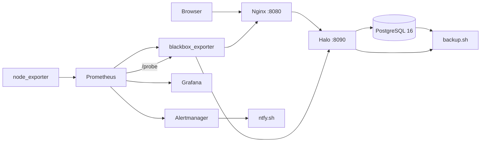

# Halo Ops Lab

一个面向「应用运维 / SRE 实习」的单机运维实践项目：把开源 Java 应用 Halo 当作生产系统，完成标准化部署、反向代理、可观测性、告警、备份恢复和故障演练。

项目重点不是 Halo 本身，而是围绕它建立一套可复用的运维闭环。

## Architecture



## Stack

| Layer | Component |
|---|---|
| Application | Halo 2.27.0 (Java / Spring Boot) |
| Database | PostgreSQL 16 |
| Reverse proxy | Nginx 1.28 |
| Metrics | Prometheus + node_exporter + blackbox_exporter |
| Dashboards | Grafana |
| Alerting | Alertmanager + ntfy.sh |
| Runtime | Docker Compose on Rocky Linux 10.2 |
| Host | Alibaba Cloud ECS, 2 vCPU / 2 GB RAM |

## What This Project Covers

- 一键拉起 Halo + PostgreSQL + Nginx
- Nginx 反向代理、上传大小、安全响应头、访问日志
- 主机、容器、应用、入口四层可观测性
- Halo 可用性、探活延迟、HTTP 状态码面板
- Halo 应用/入口故障告警，支持 resolved 通知
- PostgreSQL 逻辑备份 + Halo 数据目录备份
- 临时库恢复验证，不覆盖生产库
- 一次真实的 Nginx 故障演练：firing → 通知 → 恢复 → resolved

## Repository Layout

```text
halo-ops/
├── compose.yaml
├── .env.example
├── alertmanager/
│   ├── alertmanager.yml.example
├── blackbox/
│   └── blackbox.yml
├── blackbox-compose.yml
├── grafana/
│   └── halo-probe.json
├── nginx/
│   └── default.conf
├── prometheus/
│   ├── prometheus-blackbox-job.yml
│   └── rules/
│       └── halo-alerts.yml
└── scripts/
    ├── backup.sh
    └── restore-test.sh
```

## Quick Start

```bash
git clone https://github.com/<your-name>/halo-ops.git
cd halo-ops

cp .env.example .env
# 修改 .env：数据库密码、外部访问地址
chmod 600 .env

docker compose up -d
docker compose ps
```

首次启动后访问：

```text
http://<server-ip>:8080/console
```

## Operations

常用命令：

```bash
docker compose ps
docker compose logs --tail=100 halo
docker compose up -d
docker compose restart nginx
```

健康检查：

```bash
curl -sS http://127.0.0.1:8080/healthz
curl -sS http://127.0.0.1:8080/actuator/health/readiness
```

## Monitoring

- Prometheus 抓取 node_exporter、blackbox_exporter 和自身指标
- blackbox 同时探测：
  - `halo-app`：`http://halo:8090/actuator/health/readiness`
  - `halo-edge`：`http://nginx/healthz`
- Grafana 面板 `Halo Ops / Probe`：
  - Halo Availability
  - Probe Latency
  - HTTP Status

Grafana 不直接暴露公网，通过 SSH 隧道访问：

```bash
ssh -N -L 3000:127.0.0.1:3000 deploy@<server-ip>
```

浏览器打开 `http://127.0.0.1:3000`。

## Alerting

告警规则：

- `HaloAppDown`：应用 readiness 连续 1 分钟失败
- `HaloEdgeDown`：Nginx 入口连续 1 分钟失败
- `HaloProbeSlow`：探活耗时超过 2 秒，持续 5 分钟

通知链路：Prometheus → Alertmanager → ntfy.sh。

复制示例并替换 topic：

```bash
cp alertmanager/alertmanager.yml.example alertmanager/alertmanager.yml
# 修改 https://ntfy.sh/REPLACE_WITH_YOUR_TOPIC
```

## Backup and Restore

执行备份：

```bash
./scripts/backup.sh
```

备份内容：

- `halo-db.dump`：PostgreSQL custom-format dump
- `halo-data.tar.gz`：Halo 附件、主题、插件、密钥（排除日志）
- `SHA256SUMS`：完整性校验
- `metadata.txt`：镜像版本与备份大小

恢复验证：

```bash
LATEST=$(ls -1dt backups/*/ | head -1)
LATEST="${LATEST%/}"
./scripts/restore-test.sh "$LATEST"
```

脚本会恢复到临时库、统计表数量、验证数据包，然后删除临时库，不影响生产库。

实测（当前数据量）：

- 备份耗时约 1.4s
- 临时库恢复约 1.1s
- 生产库表：`extensions`、`migrations`

## Failure Drill

已完成的告警演练：

1. `docker compose stop nginx`
2. blackbox 的 `halo-edge` 变为 `0`
3. 约 1 分钟后 `HaloEdgeDown` 进入 `firing`
4. Alertmanager 推送 ntfy
5. `docker compose start nginx`
6. 告警恢复，ntfy 收到 `resolved`

演练期间 `halo-app` 保持 `1`，说明应用本身未被误判。

## Security Baseline

- SSH 仅允许密钥登录
- `PermitRootLogin no`
- `PasswordAuthentication no`
- 部署用户 `deploy` 通过 docker 组管理容器
- PostgreSQL 不暴露宿主机端口
- Halo 只监听 `127.0.0.1:8090`，公网只开 Nginx `8080`
- Grafana 不直接暴露公网，使用 SSH 隧道

## Known Limitations

- 单机部署，无高可用
- 无域名/备案，当前使用 HTTP + IP:8080，未启用公网 TLS
- Prometheus / Grafana / Alertmanager 仍使用旧版 `latest` 镜像，后续需要固定版本
- 监控栈暂未全部纳入本仓库的 Compose 管理
- 备份目前只在同一台服务器本地，缺少异地副本
- ntfy 通知内容为 Alertmanager 原始 JSON，后续可增加格式化中继

## Roadmap

- [ ] GitHub Actions：配置校验 + 发布 + 健康检查 + 自动回滚
- [ ] 备份定时任务与异地副本
- [ ] Prometheus / Grafana / Alertmanager 版本固定与升级
- [ ] 完整 runbook、架构决策记录和故障复盘
- [ ] 域名与 HTTPS（备案允许后）
